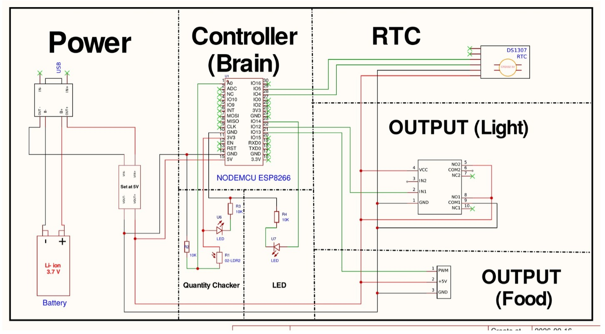
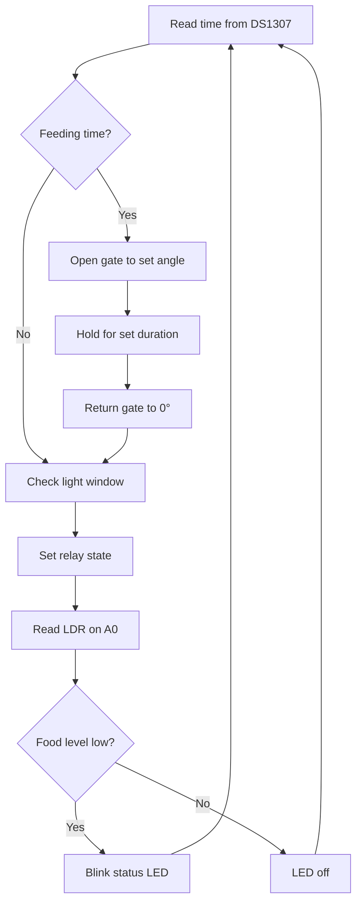
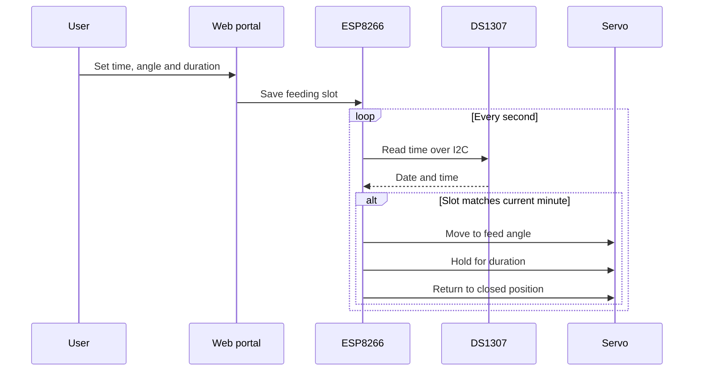

# SAFF - Smart Automatic Fish Feeder

SAFF is a low-cost, battery-backed fish feeder for home aquariums. A NodeMCU ESP8266 keeps time with a DS1307 RTC, opens a servo-driven gate to release a fixed portion of food at scheduled times, and switches the aquarium light through a relay. Feeding and light timings are set from a web portal hosted on the ESP8266 itself, so no app, cloud account, or internet connection is needed.



## How it works

The ESP8266 runs its own password-protected Wi-Fi access point (`RTC_Calibrator`) and serves a captive portal at `http://192.168.4.1`. Up to five feeding times can be stored, each with its own servo angle and duration, along with the light's ON/OFF window (default 08:00-18:00). The RTC keeps time through a power cut on a CR2032 cell, and the board runs from a 2000 mAh 18650 cell when mains power is lost.



A feeding is released once per programmed minute, so the same time can be used for more than one entry when a larger portion is needed.



## Hardware

| Block | Part | Role |
|---|---|---|
| Controller | NodeMCU ESP8266 | Runs the schedule, hosts the web portal |
| Timekeeping | DS1307 RTC + CR2032 | Keeps time without Wi-Fi or mains power |
| Food output | SG90 servo | Opens and closes the food gate |
| Light output | 2-channel 5 V relay (JQC3F-05VDC-C) | Switches the aquarium light with isolation |
| Food level | LDR + 10 kΩ divider | Coarse low-food indication on A0 |
| Charging | TP4056 | Charges the Li-ion cell from USB |
| Backup supply | 18650 Li-ion, 3.7 V, 2000 mAh | Runs the feeder through power cuts |
| 5 V rail | XL6009 boost converter | Raises the cell voltage to a steady 5 V |

| Signal | NodeMCU pin | GPIO |
|---|---|---|
| I2C clock (SCL) | D1 | GPIO5 |
| I2C data (SDA) | D2 | GPIO4 |
| Servo PWM | D7 | GPIO13 |
| Relay input | D6 | GPIO12 |
| Status LED | D5 | GPIO14 |
| Food level | A0 | ADC |

Standby current is about 100 mA at 5 V, giving roughly 10 hours on the battery; with the light on it is about 180 mA and 5.6 hours. The battery is a backup for power cuts, not the normal supply.

## PCB

The board is a single-sided design. The NodeMCU, RTC, relay, charger, and boost modules plug into female headers so they can be replaced without desoldering, and the power and servo tracks are widened for the feed current. The board was etched and drilled in the lab.


## Repository

```
hardware/           KiCad 10 project, project library tables and bundled ESP8266 library
mechanical/         printable feeder body (STL)
docs/               schematic and PCB PDFs generated by CI
pngs/               report images used in this README
.github/workflows/  KiCad PDF and fabrication export
```

Open `hardware/SDW.kicad_pro` in KiCad 10 or newer. The `KiCad` workflow regenerates `docs/SDW-schematic.pdf`, `docs/SDW-pcb-top.pdf`, and `docs/SDW-pcb-fab.pdf` on every push that changes `hardware/`. It also uploads Gerbers, drill files, and a CSV BOM as the `kicad-outputs` artifact.

## 3D design

Printable enclosure and feeder body: [Autodesk A360](https://a360.co/4jwVF6T)

## Team

System Design Workshop (24EE05PR0504), 5th semester, 2026-27. Workshop coordinator: Prof. V Lande.

Batch A4, Group G-15, Department of Electronics and Communication Engineering, Ramdeobaba University, Nagpur.

- Pranav Paunikar (53)
- Janhavi Balpande (58)
- Vaibhav Dhanore (60)
- Yadnyesh Thakare (65)
- Samarth Zalkikar (66)
